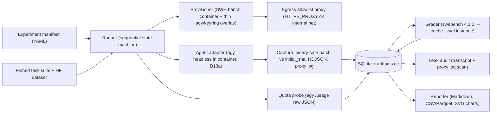

# SubscriptionBench: Implementation Plan (MVP: Antigravity + Google AI Pro)

> [!NOTE]
> **Revision 5 (2026-11-01).** Phases 0–6 are implemented and verified offline (`91 passed`, `0.00%` model quota burn across commits `5585bed`..`194d924`). Code review of Phases 3–6 uncovered targeted runtime bugs in `runner.py`, `audit.py`, `grading.py`, and `quota/base.py` (most critically a `"Problem placeholder"` stub in `Runner.run` and `tool_info` JSON-path mismatch in `audit.py`) that **must** be fixed before any live Phase 8 run. Queues those fixes + **Phase 7 (`subbench/report/`)** + quota-gated **Phase 8** execution in [`docs/handover_phases7_8.md`](handover_phases7_8.md).

---

## 1. Key findings shaping the design

| # | Finding | Why it matters | Status |
|---|---|---|---|
| F1 | The **Python SDK** and `GEMINI_API_KEY` / ADC use API or GCP billing, not the consumer subscription. | Only the **`agy` CLI in headless mode** (`agy -p … --model … --output-format stream-json`), using a consumer Google OAuth login, draws down the AI Pro allowance. | Confirmed (Phase 0) |
| F2 | `agy -p /usage --output-format json` returns **double-precision floats** per bucket, contains **zero credit/monetary fields**, and **consumes zero quota**. | Per-task quota deltas are directly measurable without spending allowance (`usage_raw_schema.json`). | Confirmed (Phase 0/3) |
| F3 | **Argon and Flash draw from disjoint quota pools.** Argon (`default`, `capable`) draws **only** from `gemini-argon-wtu-weekly` (no 5h window). Flash (`efficient`) draws from `gemini-5h` and `gemini-weekly`. | Allowance is tracked per bucket (`weekly_bucket_by_config` and `primary_bucket_by_config` in `config.py`). Reports must disclose that Flash and Argon weekly pools are separate Pro allowances, and note that `default` and `capable` **share** the single `gemini-argon-wtu-weekly` pool. | Implemented |
| F4 | AI Credits overage is disabled via `--settings '{"useG1Credits": false}'`. | Passed in every headless adapter invocation (`DEFAULT_SETTINGS`). Exact 0%-quota error text remains unverified (protected by guardrail against draining the account), so `parse_stream_json` + pre/post snapshots classify near-zero errors defensively as `quota_restricted`. | Implemented |
| F5 | `agy` returns **process exit code `0` even on auth/runtime errors** (`result.status = "ERROR"`). | `AntigravityAdapter` parses the `result` NDJSON event and never trusts exit code alone. | Implemented |
| F6 | Headless `agy` exposes web/browser tools (`search_web` runs **server-side** over Google's API), and container-wide `HTTP_PROXY` interferes with offline HTTP error tests in repos like `psf/requests`. | Combine `HTTPS_PROXY`-only egress allowlisting (`DEFAULT_EGRESS_ALLOWLIST` in `network.py`), `--disable-slash-commands`, explicit `permissions.deny` covering all 18 web/browser tool names, and offline transcript + `proxy.log` leak auditing. | Implemented (`audit.py` JSON-path fix queued) |
| F7 | In-container silent OAuth (D13a) works persistently via `dbus-launch` + `gnome-keyring-daemon` backed by named volume `subbench-agy-auth`. | Verified across multiple ephemeral `docker run --rm` containers and 3/3 resolved SWE-bench calibration runs with zero host credential copying. | Confirmed (Phase 3) |
| F8 | Disk & grader: `swebench==4.1.0` with `--cache_level instance` preserves the 12 pre-pulled images (~13 GB shared; **~38 GB free** on `/`). | Keep overlay layers thin and keep runtime artifacts under git-ignored `artifacts/`, never `experiments/`. | Implemented |

---

## 2. Suite & quota conservation rules

### 2.1 Statistical framing (`verified-mvp-v1`, 12 tasks)
- **Directional, paired comparison:** With `n=12` (4 easy, 4 medium, 4 hard across 6 repos in stratified round-robin order), aggregate Wilson 95% CIs are wide (~25–75% at 6/12). Reports emphasize the **task × config outcome matrix** and paired differences alongside aggregate efficiency.
- **Conservative pass count (`k=1` first, D15):** Calibration measured `0.687 pp` of `gemini-argon-wtu-weekly` on an easy 12-tool-call task (`pytest-dev__pytest-5809`), while Flash burned **2.75× weekly / 6.3× 5h** more on a medium task (`psf__requests-2931`) than on the easy task—and 4 of the 12 suite tasks are hard (`1-4 hours`). Because `default` (`argon-medium`) and `capable` (`argon-high`) **share** `gemini-argon-wtu-weekly`, `baseline.yaml` starts at **`passes: 1`** (12 tasks × 3 configs = 36 attempts) so one complete, balanced pass finishes across all 3 configs before deciding whether remaining weekly capacity supports a second pass.
- **Bucket-specific exhaustion rules:** Flash may wait for `gemini-5h` resets (`max_5h_windows_per_config_cycle = 2`). Weekly buckets (`gemini-argon-wtu-weekly`, `gemini-weekly`) use `on_weekly_exhaustion = "abort_config"` rather than stalling for 7 days.

### 2.2 Strict quota conservation during development & Phase 8 gating
> [!IMPORTANT]
> Weekly pools (`3p-weekly`, `gemini-weekly`, `gemini-argon-wtu-weekly`) reset only once per week and are shared with interactive development.
> 1. **Zero inference quota in Phase 7 & bugfixes (`0.00%` model burn):** All Phase 3–6 fixes and Phase 7 reporting code must be built and verified 100% offline against SQLite fixtures, `FakeAgentAdapter`, `FakeQuotaProbe`, and `tests/fixtures/calibration_sample/`.
> 2. **Two-stage gated Phase 8 execution:**
>    - **Stage 1 (`pilot-flash.yaml`):** Run only 3 tasks × `efficient-flash-medium` (~1–3 pp `gemini-weekly`, `0.00 pp` Argon weekly), then run `grade` → `audit` → `report` and **stop** for operator verification of artifacts, prompts, quota deltas, and ToS review.
>    - **Stage 2 (`baseline.yaml`):** Launch the 36-attempt cycle from a **plain host terminal (`tmux`)** with zero concurrent Antigravity IDE/chat sessions, gated on comfortable weekly pool headroom (or optional `max_weekly_fraction_per_config_cycle` cap so interactive dev never stalls).

---

## 3. Architecture



### Repository layout

```text
SubscriptionBench/
├── pyproject.toml              # uv-managed, Python 3.12 (dev + suite groups, docker marker)
├── subbench/
│   ├── cli.py                  # Typer CLI: init-db / validate / suite / quota / run / grade / audit / [Phase 7: report]
│   ├── config.py               # Strict Pydantic v2 models (bucket-validated manifests, max_passes, suites)
│   ├── store/                  # SQLite schema v2 + migrations (9 tables, WAL, FK)
│   ├── tasks/                  # Pinned HF parquet loader (.sha256 sidecar), curation, validation
│   ├── provision/              # Thin overlay builder, .git strip, egress proxy, binary-safe patch capture
│   ├── agents/                 # AgentAdapter protocol, minimal-v1 prompts, AntigravityAdapter
│   ├── quota/                  # QuotaProbe protocol, agy_usage.py, manual.py, guard functions
│   ├── runner.py               # Resumable sequential state machine
│   ├── grading.py              # Offline batch wrapper over swebench (--cache_level instance)
│   ├── audit.py                # Outbound-scoped leak scanner over NDJSON + proxy.log
│   └── report/                 # [Phase 7] Per-bucket metrics, Wilson CIs, outcome matrix, CSV/Parquet/SVG
├── suites/                     # Frozen suite manifests & validation/image records (committed)
├── experiments/                # Experiment YAML manifests ONLY: pilot-flash.yaml, baseline.yaml
├── docker/                     # Dockerfile.agy-overlay, entrypoint-agy.sh, egress_proxy.py
├── scripts/                    # Phase 0 spikes, pull_images.py, bootstrap_container_auth.sh, calibrate_phase3.py
├── docs/                       # Plan, Phase 0/3 findings, suite docs, worker handovers
├── tests/                      # Fast offline unit tests + @pytest.mark.docker integration tests
└── artifacts/ data/ logs/      # Git-ignored runtime state, patches, transcripts, reports, SQLite DB
```

---

## 4. Phased plan & current status

### Phase 0: Feasibility spike & calibration — **Complete** (except operator ToS check #11)
Recorded in [`docs/phase0_findings.md`](phase0_findings.md).
- [x] **1–9.** Binary (`v1.4.12`), models, `/usage` raw schema (zero credit fields, full float precision, zero cost), `stream-json` schema, D13(a) container silent auth via `subbench-agy-auth`, 5-host egress allowlist, blocked auto-updater (`403` tolerated cleanly), and headless permission settings verified.
- [x] **10. SWE-bench calibration:** 3/3 attempts resolved (`pytest-dev__pytest-5809` on Flash Medium & Argon Medium; `psf__requests-2931` on Flash Medium).
- [ ] **11. Terms of service:** Operator check of primary Antigravity terms prior to Phase 8 baseline.

### Phase 1: Scaffolding — **Complete**
- [x] `uv` project, `ruff`, `pytest`, CLI, SQLite schema `v2` (9 tables + `environment.execution_mode`), bucket-validated `QuotaPolicy` and `ConfigSpec.max_passes`.

### Phase 2: Task suite curation — **Complete**
- [x] Frozen `suites/verified-mvp-v1.json` (12 tasks, 2× gold/no-op validated, `--cache_level instance`, `.sha256` dataset sidecar, 12 images pre-pulled).

### Phase 3: Provisioning and agent adapter — **Complete** (`5585bed`)
- [x] Thin overlay & keyring auth, `HTTPS_PROXY`-only task container networking, `DEFAULT_EGRESS_ALLOWLIST`, `--disable-slash-commands`, 18-tool web/browser `permissions.deny`, daemon-thread stdout streaming with real subprocess timeout & in-container `pkill`, binary-safe patch capture (`unstage_binary_files`), and `experiments/` repo hygiene.
- [ ] **Minor adapter follow-up (queued in Phase 7–8 Milestone 1):** Persist `stderr` stream to `attempt_dir / "stderr.txt"` so `attempts.stderr_path` resolves on disk.

### Phase 4: Quota probe — **Implemented** (`0a556d1`, fixes in `df8e6de`)
- [x] `QuotaSnapshot`, `parse_usage_json` (with rolling `pre == 1.0` first-spend handling and defensive credit-field check), `detect_external_use`, `check_idle`, `save_quota_snapshot`, `AgyUsageProbe` (`subbench-agy:probe`), `ManualQuotaProbe`, and `subbench quota snapshot`.
- [x] **Resolved fix (`quota/base.py` in `df8e6de`):** Scoped `compute_attempt_deltas` `invalid_reset` detection to `watched_buckets` (`config.buckets`) so unrelated resets on `3p-5h` or `gemini-5h` never invalidate an Argon attempt.

### Phase 5: Runner — **Implemented** (`6e95bc9`, fixes in `df8e6de`)
- [x] Pass-interleaved schedule, SQLite state machine (`PENDING → ... → QUOTA_POST`), crash/resume recovery, `retry_of` tracking, and `subbench run [--dry-run]`.
- [x] **Resolved fixes (`df8e6de`):**
  1. **CRITICAL — Load real SWE-bench `problem_statement`:** Replaced hardcoded `problem_statement="Problem placeholder"` in `Runner.run` with pinned dataset lookup (`subbench.tasks.dataset.fetch(suite.dataset_revision)` / `load_rows`, plus injectable mapping for offline tests), and configured `[tool.uv] default-groups = ["dev", "suite"]` in `pyproject.toml`.
  2. **HIGH — Container/proxy cleanup safety:** Wrapped `task_env = self.provisioner.provision(...)` in `try ... finally: task_env.cleanup()` so exceptions or `Ctrl-C` never leak `subbench-task-*` or `subbench-proxy` containers.
  3. **MEDIUM — Quota-policy & metadata completeness:** Enforced `max_weekly_fraction_per_config_cycle`, checked pre-attempt `5h` exhaustion (`<= 1e-3`) before provisioning, generalized `5h` bucket detection across `config.buckets` (plus near-limit `quota_restricted` handling when `remaining_fraction > 1e-3`), recorded real `agy`/`docker`/`swebench` versions and template SHA-256 in `record_environment`, and validated `agy_path`/Docker/suite images in `run_preflight`.

### Phase 6: Grading and audit — **Implemented** (`194d924`, fixes in `df8e6de`)
- [x] Unique-`instance_id` batching (`partition_into_unique_instance_batches`), empty-patch short-circuiting, per-instance `report.json` parsing, idempotent `audit_findings` persistence, and `subbench grade` / `subbench audit`.
- [x] **Resolved fixes (`df8e6de`):**
  1. **CRITICAL — Fix `audit_ndjson_events` `tool_info` JSON path & deduplication:** Extracted `CommandLine` and `output` from `step["tool_info"]["parameters"]` and `step["tool_info"]["output"]` (matching real `agy` v1.4.12 NDJSON), inspect `state != "ACTIVE"` so `ACTIVE`+`DONE` pairs do not double-fire, count actual `git log` commit headers (`(?m)^commit\s+[0-9a-f]{40}\b`) rather than arbitrary 40-hex strings in file diffs, and pass derived `task_repo` in `audit_cycle`.
  2. **HIGH — Preserve exact unified diff formatting in `grading.py`:** Removed `.strip()` when loading `patch_path` (preserving exact hunk line counts and trailing context lines `" \n"`), using `.strip()` only for emptiness detection, and auto-materialize `dataset.jsonl` from the pinned parquet cache if absent.

### Phase 7: Metrics and reporting — **Implemented** (`7367ade`)
- [x] **SQLite query & metric engine (`subbench/report/metrics.py`):**
  - Evaluates task resolution on the **final** attempt per `(config_id, instance_id, pass_index)` (`MAX(seq)`), while summing quota consumption across **all `valid = 1` attempts** for that config (including aborted/retried attempts per D9; pairing efficiency numerator `resolved_valid` with `valid = 1` quota denominator so `invalid_reset` attempts never skew efficiency).
  - Computes **both** `primary_bucket` and `weekly_bucket` metrics per config: consumed fraction & percentage points (`pp`), projected `tasks_per_full_bucket`, `pct_points_per_resolved_task`, raw resolve rate (`resolved / planned` and `resolved / attempted`), pure-Python **Wilson 95% CIs**, median/max `wall_seconds`, median `tool_calls`, token totals, failure/halt taxonomy (`completed`, `timeout`, `quota_restricted`, `agent_error`, `infra_error`, `empty_patch`, `patch_apply_failed`), and contamination/audit counts.
  - Builds the **paired `12 × config` outcome matrix** (`instance_id`, `repo`, `difficulty`, per-config status, wall time, weekly `pp`, tool calls) and optional **longitudinal delta** table against a prior cycle on the same `suite_digest`.
- [x] **Renderers & exports (`subbench/report/render.py`, `export.py`, `charts.py`):**
  - `summary.md`: GFM report with mandatory pool-sharing/disjoint-bucket disclosures (F3), summary metrics, paired task matrix, halt/audit breakdown, and longitudinal deltas.
  - `attempts.csv`, `attempts.parquet`, `config_metrics.csv`, `config_metrics.parquet`.
  - Pure-Python zero-dependency **SVG charts** (`efficiency_vs_accuracy.svg`, `task_matrix.svg`).
- [x] **CLI:** `subbench report --cycle-id ID [--compare-cycle-id ID] [--out-dir PATH] [--db PATH]`.
- [x] **Offline Test Suite:** 5 comprehensive integration tests in `tests/test_report.py` (Wilson score intervals, retry quota summing, early aborts, SVG validation, Parquet roundtrip, leak warning banners, longitudinal CLI comparison).

### Phase 8: Pilot, then baseline — **In Progress (Pre-flight verified, Quota-Gated)**
- [x] **Pre-flight verification (`0.00%` model quota):**
  - All 103 offline unit tests green across all modules (`store`, `config`, `quota`, `curate`, `dataset`, `prompts`, `grading`, `audit`, `runner`, `report`).
  - Dry-run validation passed for both `pilot-flash.yaml` (3 attempts) and `baseline.yaml` (36 attempts).
  - All 12 evaluation docker images (`swebench/sweb.eval.*`) present locally.
  - Host disk space verified (38 GB available, >= 30 GB threshold).
  - Zero-cost live quota snapshot verified: `gemini-5h` at 79.51% (>= 25% required), `gemini-weekly` at 82.58% (>= 15% required), `gemini-argon-wtu-weekly` at 75.57%.
- [ ] **Stage 1 (`pilot-flash.yaml`):** 3 tasks × `efficient-flash-medium` → `grade` → `audit` → `report` → mandatory operator inspection gate (~1–3 pp `gemini-weekly`, `0.00 pp` Argon weekly).
- [ ] **Stage 2 (`baseline.yaml`):** 12 tasks × 3 configs × `passes: 1` (36 attempts), launched only when `gemini-argon-wtu-weekly` and `gemini-weekly` have safe headroom (or after weekly reset) so interactive development never stalls.

### Phase 9: Longitudinal automation (post-baseline)
- Bi-weekly systemd user timer with pre-run idle check and longitudinal report generation (`--compare-cycle-id`).

---

## 5. Decisions

### 5.1 Resolved

| ID | Decision |
|---|---|
| D1 | `agy` CLI in headless mode only (no SDK / API keys). |
| D2 / D13 | **Option (a) verified & active:** In-container `agy` using a one-time official OAuth login persisted in named Docker volume `subbench-agy-auth` (`dbus-launch` + `gnome-keyring-daemon`). **Option (c)** retained below as documented fallback. |
| D3 | Full 12-task suite per config in immutable round-robin order (`verified-mvp-v1`). Per-attempt deltas summed; 2 × 5h window cap for 5h buckets; `abort_config` on weekly bucket exhaustion. |
| D4 | `--internal` Docker network + `HTTPS_PROXY` allowlist proxy + `--disable-slash-commands` + `--settings` `permissions.deny` on web/browser tools + post-run transcript/`proxy.log` leak audit. |
| D5 / D5a | **12 tasks** frozen in `suites/verified-mvp-v1.json`. |
| D6 | Only the 3 Google Pro baselines (`default`, `efficient`, `capable`). |
| D7 / D15 | **Start baseline at `k = 1` pass (`passes: 1`), with optional `ConfigSpec.max_passes` support:** Because `default` and `capable` share `gemini-argon-wtu-weekly` and medium/hard tasks cost multiples of easy tasks, complete 1 full matched pass across all 3 configs first; run a 2nd pass (`k=2`) only when remaining weekly Argon/Gemini quota safely permits. |
| D8 | Personal Google AI Pro account with pre-run idle check, inter-attempt contamination guard, and no concurrent Gemini sessions during benchmark cycles. |
| D9 | Interrupted attempts are **discarded and re-run** when eligible (quota cost of `valid=1` attempts still counted in efficiency denominator; task resolution scored on final attempt). |
| D10 | SQLite as source of truth; CSV and Parquet exports + SVG charts. |
| D11 | Per-task wall-clock timeout: **45 minutes** (with in-container process-tree kill). |
| D12 | Minimal, versioned, SHA-256-hashed prompt template (`minimal-v1`). |
| D14 | **Config → model mapping:** `default` = `gemini-4-argon-medium`, `efficient` = `gemini-3.8-flash-medium`, `capable` = `gemini-4-argon-high`. |

### 5.2 Open pre-baseline operator item

| ID | Item | Action |
|---|---|---|
| ToS | **Terms review (Phase 0 #11)** | Operator reviews primary Antigravity terms before kicking off Phase 8 baseline. |

### 5.3 Documented fallback for D13: Option (c) — Hybrid host `agy` + air-gapped `testbed` container
*(Retained for contingency if a future `agy` update breaks headless Linux container keyring auth.)*
1. Extract `/testbed` at `base_commit` into `/tmp/subbench-attempt-<id>/testbed`, strip `.git` to `<initial_sha>`, and bind-mount at `/testbed` into a `--network none` SWE-bench container.
2. Run host `agy` (`--sandbox`, `--disable-slash-commands`, `--settings` denying web/browser tools and paths outside `/tmp/subbench-attempt-<id>/testbed`).
3. Route test execution through a single-purpose `testbed-exec` wrapper into `/opt/miniconda3/envs/testbed`, logging `execution_mode = "hybrid_host"` in `environment`.

---

## 6. Risks

| Risk | Impact | Mitigation |
|---|---|---|
| Limited weekly quotas during dev & runs | Stalls dev or truncates baseline | Zero-inference-quota testing for Milestone 1 & Phase 7; two-stage Phase 8 gate (`pilot-flash.yaml` → inspect → `baseline.yaml`); `max_weekly_fraction_per_config_cycle` & `abort_config` |
| Shared `gemini-argon-wtu-weekly` across `default` & `capable` | Combined 24-attempt burn may approach weekly cap | Pass-interleaved order (`passes: 1`), weekly headroom check before Stage 2, balanced round-robin prefixes |
| Unrelated bucket reset (`3p-5h` / `gemini-5h`) mid-attempt | Falsely invalidates Argon quota delta | Scope `compute_attempt_deltas` `invalid_reset` check to `config.buckets` |
| Truncated or whitespace-stripped patches | `git apply` fails during `swebench` grading | Binary-safe capture + preserve exact raw diff bytes/newlines in `grading.py` |
| Concurrent Antigravity session on same Google account | Contaminates `gemini-5h` / `gemini-weekly` / Argon | Run Phase 8 from a plain host `tmux` terminal; pre-run idle check + `external_use` guard |
| Disk headroom (`~38 GB` free on `/`) | Image or log bloat fills partition | Thin overlays, `--cache_level instance`, `try/finally` container cleanup, pre-flight free-disk check, artifacts git-ignored |
