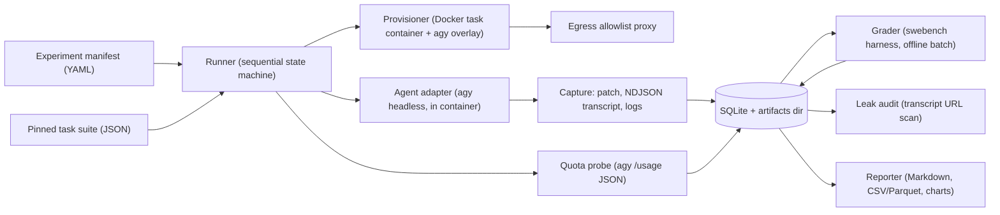

# SubscriptionBench: Implementation Plan (MVP: Antigravity + Google AI Pro)

> [!NOTE]
> **Revision 2 (2026-10-31).** Changes: suite reduced to **9–12 tasks**, `agy` is now installed, and about 30–50 GB more disk is being freed. Claims about CLI flags, JSON fields and quota behaviour are still **hypotheses until Phase 0 confirms them**.

---

## 1. What I found that changes the design

| # | Finding | Why it matters | Status |
|---|---|---|---|
| F1 | The **Python SDK** appears to authenticate with a Gemini API key or Vertex credentials, which means API billing, not the subscription. | Only the **`agy` CLI in headless mode** (`agy -p … --model … --output-format stream-json --dangerously-skip-permissions`), using your cached Google login, draws down the AI Pro allowance. | Decided: CLI only |
| F2 | Quota is reportedly exposed as **`remaining_fraction` per bucket**, with a **5-hour** window and a **weekly** cap (`agy -p /usage --output-format json`). | Automated quota reading looks possible. The **precision** of the number decides whether per-task cost can be measured. | Verify in Phase 0 |
| F3 | There is an **AI Credits overage** setting (`useAiCredits` / `useG1Credits`). | It must be off, or runs silently switch to paid credits when the allowance runs out. | Verify in Phase 0 |
| F4 | Gemini models probably **share one quota pool**. | Configs run one after another. **Any other use of the account** (including Antigravity app or IDE sessions) contaminates the measurement. | Mitigated (contamination guard) |
| F5 | SWE-bench images may contain the repo's **future git history**. Web access would let the agent find the upstream fix. | Strip history, use an egress allowlist, audit transcripts. | Decided |
| F6 | `/var` had about 51 GB free. You're freeing **30–50 GB more**, so about 80–100 GB will be available. | A 9–12-task suite needs roughly **15–35 GB** of images. | **Resolved** |
| F7 | `agy` is installed, but it may not be on PATH in every shell environment (e.g. sandboxed agent shells; only `~/.config/Antigravity/bin/agy-node` was found there). | The runner needs an absolute `agy` path configured in the manifest. Phase 0 will confirm the path. | Phase 0 |

---

## 2. What a 9–12-task suite means for the design

A small suite is a good choice for the MVP: it's cheap in quota and disk, and fast to iterate on. It does change what the results can claim:

- **Statistical power is low.** With n=12, a resolve rate of 6/12 has a Wilson 95% CI of about **25–75%**, so typical gaps between configs **won't be statistically distinguishable**. The MVP should be presented as **validating the protocol and pipeline**, with directional results, not a definitive ranking.
- **Compare configs task by task.** All configs run the same tasks, so the report shows a **task × config outcome matrix** (resolved / failed / not attempted) and paired differences (McNemar-style counts), not just aggregate rates.
- **Repeats are now affordable.** 12 tasks × 3 configs = 36 attempts per pass. Running **k=2–3 passes** would separate model differences from run-to-run noise (agent runs are non-deterministic). See open decision D7.
- **The 2-window cap is unlikely to bind** for the efficient and default models at this size. It still protects against the capable model running long. The stratified task order is kept so a truncated run is still balanced.
- **"Tasks resolved before throttling" may never be reached.** In that case, report the measured ratio **resolved per unit of window fraction consumed** (e.g. "≈ N resolved per full 5h window"), clearly labelled as a projection from measured consumption. This is a ratio of observed quota, not an estimate from API token prices, so it stays within the README's rule.
- **Quota precision matters even more.** With only 12 attempts per config, batch-level measurement (if precision is coarse) gives just 2–3 data points. If `remaining_fraction` turns out coarse, k=2–3 repeats are the main way to get a usable cost signal.

---

## 3. Proposed architecture



**Key principle:** keep **agent execution** (uses quota, strictly one task at a time) separate from **grading** (no quota, can run in parallel and be re-run at any time).

### Repository layout

```
SubscriptionBench/
├── pyproject.toml              # uv-managed, Python 3.12
├── subbench/
│   ├── cli.py                  # Typer CLI: suite / run / grade / audit / report / quota
│   ├── config.py               # Pydantic models for manifests
│   ├── store/                  # SQLite schema + migrations, Parquet/CSV export
│   ├── tasks/                  # SWE-bench loader, suite curation, validation
│   ├── provision/              # Docker task-container builder (agy overlay, history strip)
│   ├── agents/
│   │   ├── base.py             # AgentAdapter protocol (future: claude_code.py, codex.py)
│   │   └── antigravity.py      # agy headless driver + stream-json parser
│   ├── quota/
│   │   ├── base.py             # QuotaProbe protocol
│   │   ├── agy_usage.py        # automated probe
│   │   └── manual.py           # fallback: operator checkpoints, provenance=manual
│   ├── runner.py               # resumable sequential state machine
│   ├── grading.py              # wraps swebench.harness.run_evaluation
│   ├── audit.py                # leak detection over transcripts
│   └── report/                 # metrics, CIs, outcome matrix, longitudinal deltas
├── suites/                     # pinned suite manifests (committed)
├── experiments/                # experiment manifests (committed)
├── docker/                     # agy overlay Dockerfile, egress proxy config
├── docs/                       # phase0_findings.md, protocol.md
├── tests/                      # unit tests (parsers, state machine, metrics)
└── artifacts/ data/ logs/      # git-ignored
```

---

## 4. Phased plan

### Phase 0: Feasibility spike (go/no-go, about 1 day)
Results are recorded in `docs/phase0_findings.md`.

1. ~~Install `agy`~~ (done). Find the absolute binary path and record `agy --version`. Confirm headless `-p` reuses the cached login.
2. `agy models`: exact model identifiers, and which one is the **default**. Map them to the three configs (default / efficient / capable).
3. `agy -p /usage --output-format json`: schema, **precision of `remaining_fraction`**, bucket names, `reset_time` semantics (rolling or fixed), and whether Flash and Pro share a bucket. Also check: **does the `/usage` call itself use quota?**
4. `stream-json` event schema: tool calls, final message, token usage fields (if any), and the **error event or exit code for "quota exhausted"**.
5. Turn AI Credits off and confirm the setting takes effect in headless mode.
6. **Config isolation:** run `agy` with a clean HOME or config dir so your global rules, skills, plugins and MCP servers don't leak into runs.
7. **Auto-update:** can it be pinned or disabled during a run?
8. **In-container execution (go/no-go for D2):** does `agy` run inside an SWE-bench instance image? Check glibc, agy's own sandbox nested inside Docker, the credential mount, and whether token refresh needs write access.
9. **Egress capture:** record which hosts agy contacts (DNS or proxy log), to build the allowlist.
10. **Calibration:** run 2–3 easy tasks on the efficient model. Check probe resolution, cost per task, and wall-clock time.
11. Check the terms of service for automated headless use of the subscription.

### Phase 1: Scaffolding (about 0.5–1 day)
- `uv` project, ruff, pytest. Pydantic manifest schema, Typer CLI skeleton, SQLite schema.
- **Tables:** `experiments`, `configs`, `cycles`, `attempts`, `quota_snapshots`, `agent_events`, `grades`, `audit_findings`, `environment` (agy version and path, model id, OS, Docker, swebench version, dataset revision, prompt hash).

### Phase 2: Task suite curation (about 0.5–1 day)
- Source: **SWE-bench Verified**, with the HF dataset revision pinned.
- **Target composition (12 tasks):** 4 × `<15 min fix`, 4 × `15 min–1 hour`, 4 × `1–4 hours`. Skip `>4 hours` (only a handful exist, and they're likely to fail for every config, which tells us nothing). For a 9-task suite, use 3/3/3.
- **Repo diversity vs disk:** spread the tasks across **4–6 repos** (e.g. django, sympy, sphinx, pytest, astropy, requests), so environment images are shared and disk use stays bounded. Avoid repos with very heavy or compile-intensive environments.
- Selection by fixed seed, then **validation**: gold patch → PASS, empty patch → FAIL, stable over 2 grading runs. Replace any failing candidate with the next one from the same stratum.
- Freeze as `suites/verified-mvp-v1.json`, with an immutable **stratified round-robin order**. A later, larger suite becomes `v2`. Longitudinal comparisons only compare runs on the same suite version.
- Pre-build all images and record the actual disk footprint.

### Phase 3: Provisioning and agent adapter (about 2 days)
- **Workspace:** the SWE-bench instance image plus an **agy overlay layer**. The repo at `base_commit` is copied into a **fresh single-commit git repo** (no history, no remote).
- **Network:** an internal Docker network whose only exit is an **egress allowlist proxy** (hosts from Phase 0 item 9).
- **Prompt template** (versioned, hash stored per attempt): the issue text, the repo path, and "resolve autonomously, do not ask questions". No hints about tests.
- **Driver:** `agy --model <id> --dangerously-skip-permissions --output-format stream-json -p <prompt>`, with a **45-min** wall-clock timeout and the process group killed on timeout.
- **Capture:** NDJSON transcript, stdout and stderr, exit code, and the patch from `git add -A && git diff --cached <base>` (binary files excluded).
- An `AgentAdapter` protocol so Claude Code and Codex can be added later.

### Phase 4: Quota probe (about 0.5 day)
- `QuotaProbe.snapshot() -> {bucket, window, remaining_fraction, reset_time, raw_json, provenance}`.
- Snapshots before and after every attempt. A window reset during an attempt is marked `invalid_reset`.
- **Contamination guard:** a quota drop between `post(i)` and `pre(i+1)` is recorded as `external_use`, and the attempt or cycle is flagged. There is also a 2-minute idle check before starting.
- Manual fallback with `provenance=manual`.

### Phase 5: Runner (about 1–1.5 days)
- States: `PENDING → PROVISIONED → QUOTA_PRE → RUNNING → HALTED(reason) → CAPTURED → QUOTA_POST → GRADED`.
- Halt reasons: `completed | timeout | agent_error | infra_error | quota_restricted`.
- Resumable through SQLite, strictly sequential.
- **Quota exhaustion:** the attempt is discarded (its cost still counts). The runner waits for `reset_time` and re-runs that task from scratch. **Hard cap: 2 × 5h windows per config per cycle.**
- **Pass structure (if k>1):** pass 1 runs all configs, then pass 2 runs all configs, and so on, not all passes of one config back to back. That way a time-of-day or server-side drift affects every config equally.
- Pre-flight: AI Credits off, model available, agy version recorded, disk free, no external use detected.

### Phase 6: Grading and audit (about 1 day)
- `predictions.jsonl` → `swebench.harness.run_evaluation --instance_ids …`, with parallel workers.
- Results stored in `grades` (resolved, FAIL_TO_PASS / PASS_TO_PASS, apply failures).
- **Leak audit:** scan transcripts for upstream repo, PR, issue or commit URLs and `git log --all`-style probing. A hit puts the attempt in `audit_findings` and flags it in the report. It isn't deleted.

### Phase 7: Metrics and reporting (about 1 day)
- **Allowance unit:** a fraction of the 5h window (headline: "resolved per full 5h window"), plus a fraction of the weekly cap.
- **Efficiency** = resolved / Σ valid allowance consumed (aborted attempts included).
- Always side by side: resolve rate with a Wilson CI, coverage, median and max wall-clock, efficiency (bootstrap CI if k>1), failure taxonomy, quota interruptions, external-use and audit flags, quota per successful task.
- **Task × config outcome matrix** and paired differences.
- An explicit "measurement limitations" section (probe precision, n=12, contamination flags).
- Outputs: `reports/<cycle>/summary.md`, CSV and Parquet, a few charts.

### Phase 8: Pilot, then baseline
- Pilot: 3 tasks × 1 config (end-to-end check).
- Baseline: 12 tasks × 3 configs × k passes.
- **Rough quota footprint:** at about 36 attempts per pass, a single pass probably fits within 1–3 Gemini windows in total. Phase 0 calibration will refine this.

### Phase 9: Longitudinal automation
- A systemd user timer for the bi-weekly cycle, with notifications. The runner checks for external use before starting and defers if it finds any.
- Drift guard: changes in agy version or model list are recorded and labelled in the report.

**Rough total effort to the first baseline:** about 7–9 working days (previously about 10–12).

---

## 5. Decisions

### Resolved

| ID | Decision |
|---|---|
| D1 | `agy` CLI in headless mode. No SDK. |
| D2 | Agent runs inside the SWE-bench task container (subject to the Phase 0 go/no-go). |
| D3 | Full suite per config. Per-attempt deltas are summed. Hard cap of 2 × 5h windows per config per cycle. Stratified round-robin order. |
| D4 | Egress allowlist proxy plus transcript leak audit. |
| D5 | **Suite of 9–12 tasks** (default 12: 4/4/4 by difficulty, across 4–6 repos). |
| D6 | Only the 3 Google baselines. |
| D8 | Personal account, with the contamination guard. |
| F6 | Disk: about 80–100 GB available once the space is freed. Enough. |

### Still open (my defaults apply unless you say otherwise)

| ID | Decision | Options | Recommendation |
|---|---|---|---|
| D5a | **Exact suite size** | 9 (3/3/3) or 12 (4/4/4) | **12**: one more task per difficulty level, at small extra cost. |
| D7 | **Repeats** | k=1 / 2 / 3 | **k=2** for the baseline. With n=12 a single pass is very noisy, and a second pass doubles the data for about 36 more attempts. |
| D9 | Interrupted attempts | Discard and re-run, or resume | **Discard and re-run** (cost counted). |
| D10 | Storage | — | SQLite as the source of truth, CSV and Parquet exports. |
| D11 | Per-task timeout | 30 / 45 / 60 min | **45 min**. |
| D12 | Prompt template | Minimal, or SWE-agent style | **Minimal**, versioned and hashed. |

---

## 6. Risks

| Risk | Impact | Mitigation |
|---|---|---|
| Small n (9–12) | Config differences not statistically significant | Present as protocol validation; paired outcome matrix; k=2 repeats |
| Quota precision too coarse | No per-task cost | Repeats and per-pass totals; report the resolution explicitly |
| Rolling-window refresh during a run | Understated cost | Detect `reset_time` changes; mark `invalid_reset` |
| Use of the personal account during runs | Overstated cost | External-use guard; pre-run idle check |
| agy won't run inside the task container | D2 fallback needed | Host worktree mode, documented as a deviation |
| SWE-bench Verified in training data | Inflated resolve rates | Affects every config equally; stated in the report |
| `agy` CLI or JSON changes | Parser breaks | Version-pinned parser tests; raw NDJSON kept permanently |
| Server-side routing or quota policy changes | Breaks longitudinal comparability | Record versions and model IDs; label drift |
