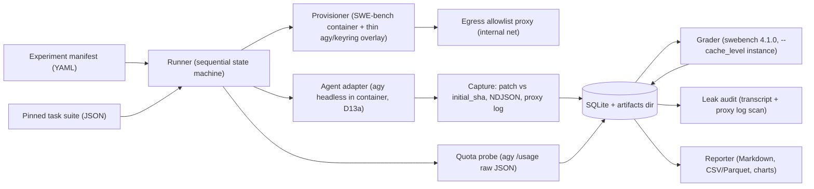

# SubscriptionBench: Implementation Plan (MVP: Antigravity + Google AI Pro)

> [!NOTE]
> **Revision 3 (2026-11-01).** Incorporates Phase 0 empirical findings, freezes Phases 1–2 (`verified-mvp-v1`, 12 tasks), resolves **D13** (Option (a) in-container `agy` with a persistent OAuth/keyring Docker volume; Option (c) hybrid documented as fallback) and **D14** (`efficient` = `gemini-3.8-flash-medium`), and scopes the Phase 3 work batch (see [`docs/handover_phase3.md`](handover_phase3.md)).

---

## 1. Key findings shaping the design

| # | Finding | Why it matters | Status |
|---|---|---|---|
| F1 | The **Python SDK** and `GEMINI_API_KEY` / ADC use API or GCP billing, not the consumer subscription. | Only the **`agy` CLI in headless mode** (`agy -p … --model … --output-format stream-json`), using a consumer Google OAuth login, draws down the AI Pro allowance. | Confirmed (Phase 0) |
| F2 | `agy -p /usage --output-format json` returns **double-precision floats** per bucket and **consumes zero quota**. | Per-task quota deltas are directly measurable (a trivial Flash call moved `gemini-5h` by 0.017 pp; a trivial Argon call moved `gemini-argon-wtu-weekly` by 0.127 pp). | Confirmed (Phase 0) |
| F3 | **Argon and Flash draw from disjoint quota pools.** Argon (`default`, `capable`) draws **only** from `gemini-argon-wtu-weekly` (no 5h window). Flash (`efficient`) draws from `gemini-5h` and `gemini-weekly`. | There is **no single shared bucket ID** across configs. Allowance must be tracked per bucket; cross-config comparison normalizes by each config's respective weekly pool (`gemini-weekly` for Flash, `gemini-argon-wtu-weekly` for Argon), clearly labelled as two separate weekly Pro pools. | Confirmed; `config.py` fix queued |
| F4 | AI Credits overage is controlled by `--settings '{"useG1Credits": false}'`. | Accepted per-session in headless mode; exact behaviour at 0% quota is unverified without draining the account, so the probe must also inspect raw `/usage` JSON for credit fields as a hard stop. | Partial (Phase 0) |
| F5 | `agy` returns **process exit code `0` even on auth/runtime errors** (`result.status = "ERROR"`). | The adapter must parse the final `result` NDJSON event and never rely on exit code alone. | Confirmed (Phase 0) |
| F6 | Headless `agy` exposes **web and browser tools** (`search_web`, `read_url_content`, `open_browser_url`), and `search_web` executes **server-side** over Google's API channel. | An egress proxy blocks shell/browser access to `github.com`, **not** server-side `search_web`. Phase 3 must also block web/browser tools via `--settings` `permissions.deny` (and pass `--disable-slash-commands`), backed by the transcript leak audit. | Confirmed; mitigate in Phase 3 |
| F7 | Linux `agy` stores OAuth tokens in the **D-Bus Secret Service keyring** (`libsecret`), not in `~/.gemini` files. | In-container execution (D13a) requires a named Docker volume paired with `dbus-run-session` + an unlocked `gnome-keyring-daemon` inside the container, initialized once via `agy`'s official OAuth flow. | Spike at start of Phase 3 |
| F8 | Disk & grader: `swebench==4.1.0` is pinned (5.x requires an `image` column absent from the pinned dataset). The 12 pulled instance images take ~13 GB shared on `/`, leaving **~37 GB free**. | Keep overlay layers thin (no `/testbed` copy at image-build time) and pass `--cache_level instance` to `swebench` so grading never deletes pre-pulled instance images. | Confirmed (Phase 2) |

---

## 2. What a 12-task suite means for the design

Suite `verified-mvp-v1` freezes 12 validated tasks (4 `<15 min fix`, 4 `15 min - 1 hour`, 4 `1-4 hours` across 6 repos in stratified round-robin order):

- **Statistical power is directional, not definitive.** With `n=12`, a resolve rate of 6/12 has a Wilson 95% CI of roughly **25–75%**. Present the MVP as validating the protocol and pipeline, using a **task × config outcome matrix** and paired counts alongside aggregate rates.
- **Repeats (`k=2`) separate model signal from run-to-run noise.** Because `/usage` has full float precision, repeats are no longer needed for quota resolution, only for agent variance—and remain subject to Argon weekly capacity (D15, checked during calibration).
- **Bucket-specific caps replace a universal 2 × 5h cap.** Flash can wait for a `gemini-5h` reset (capped at 2 × 5h windows per cycle). Argon has only a 7-day bucket (`gemini-argon-wtu-weekly`), so waiting for resets across weeks is impractical; if Argon exhausts its weekly pool (or exceeds a configured per-cycle fraction cap), the runner halts that config cleanly and records truncated coverage over the balanced round-robin order.
- **Projected throughput per pool.** When a config finishes without exhausting its pool, report observed **resolved tasks per 100% of its primary/weekly allowance pool** (a ratio of measured subscription consumption, never estimated from API token prices).

---

## 3. Architecture



**Core principle:** keep **agent execution** (consumes subscription quota, strictly sequential) separate from **grading** (consumes zero quota, offline and repeatable).

### Repository layout

```text
SubscriptionBench/
├── pyproject.toml              # uv-managed, Python 3.12 (dev + suite groups)
├── subbench/
│   ├── cli.py                  # Typer CLI: init-db / validate / suite / (next: calibrate, run, grade, audit, report)
│   ├── config.py               # Strict Pydantic v2 models for experiment & suite manifests
│   ├── store/                  # SQLite schema + migrations (9 tables, WAL, FK)
│   ├── tasks/                  # Pinned HF parquet loader, seeded curation, harness validation
│   ├── provision/              # [Phase 3] Overlay builder, .git history strip, egress proxy, patch capture
│   ├── agents/
│   │   ├── base.py             # [Phase 3] AgentAdapter protocol (future: claude_code.py, codex.py)
│   │   ├── prompts.py          # [Phase 3] Versioned, hashed prompt templates (minimal-v1)
│   │   └── antigravity.py      # [Phase 3] agy headless driver + stream-json parser
│   ├── quota/                  # [Phase 4] QuotaProbe protocol, agy_usage.py, manual.py
│   ├── runner.py               # [Phase 5] Resumable sequential state machine
│   ├── grading.py              # [Phase 6] swebench.harness.run_evaluation (--cache_level instance)
│   ├── audit.py                # [Phase 6] Transcript + proxy log leak scanner
│   └── report/                 # [Phase 7] Per-bucket metrics, CIs, outcome matrix, longitudinal deltas
├── suites/                     # Frozen suite manifests & validation/image records (committed)
├── experiments/                # Experiment manifests: pilot-flash.yaml, baseline.yaml (committed)
├── docker/                     # [Phase 3] Thin agy/keyring overlay Dockerfile & egress proxy
├── scripts/                    # Phase 0 spikes, pull_images.py, container auth bootstrap
├── docs/                       # Plan, Phase 0 findings, suite docs, worker handover
├── tests/                      # Unit & gated Docker integration tests
└── artifacts/ data/ logs/      # Git-ignored runtime state
```

---

## 4. Phased plan & current status

### Phase 0: Feasibility spike — **Mostly complete** (carry-overs in Phase 3 batch)
Recorded in [`docs/phase0_findings.md`](phase0_findings.md).
- [x] **1–3. Binary, models, `/usage` precision & zero cost:** `/home/john/.local/bin/agy` v1.4.12; 13 models; disjoint Argon (`gemini-argon-wtu-weekly`) vs Flash (`gemini-5h`, `gemini-weekly`) pools; double-precision floats; rolling reset from first spend.
- [x] **4. `stream-json` schema:** `init`, `step_update`, `result` events and token counters verified; `exit_code == 0` on error quirk identified. *(Exact quota-exhaustion error string remains unverified without draining the account; handle defensively.)*
- [x] **5–7. `useG1Credits: false`, config isolation, auto-update check:** Verified on host. *(Carry-over: inspect full raw `/usage` JSON for credit-balance fields; test blocking updater host at egress proxy.)*
- [ ] **8. In-container execution & auth persistence (D13a):** `agy --version` runs in Bookworm/Jammy (`glibc 2.35`). **Next:** build thin keyring overlay + named `subbench-agy-auth` volume, complete one-time official `agy` OAuth login, and verify silent auth across two fresh `docker run --rm` runs.
- [ ] **9. Egress host capture & tool-deny check:** Capture exact TLS SNI / DNS hosts during a container run for the allowlist, and verify `--settings` `permissions.deny` blocks server-side `search_web`, `read_url_content`, and browser tools.
- [ ] **10. SWE-bench calibration:** Run 2–3 tasks from `verified-mvp-v1` through the Phase 3 provisioner + adapter (Flash Medium + at least 1 Argon run to size `gemini-argon-wtu-weekly` for D15).
- [ ] **11. Terms of service:** Operator review of primary Antigravity terms prior to Phase 8 baseline.

### Phase 1: Scaffolding — **Done** (targeted fixes queued in Phase 3 batch)
- [x] `uv` project, `ruff`, `pytest`, Typer CLI skeleton (`init-db`, `validate`, `suite`), 9-table SQLite schema (`subbench/store/schema.py`), strict Pydantic manifests (`subbench/config.py`), `baseline.yaml` and `pilot-flash.yaml`.
- [ ] **Queued fixes:** Replace `QuotaPolicy.common_unit_bucket` with per-config `weekly_bucket_by_config`, enforce `KNOWN_BUCKETS` and config-bucket membership validation, add bucket-aware exhaustion policy (`max_5h_windows_per_config_cycle` vs Argon weekly abort/cap), and record `execution_mode` in `environment`.

### Phase 2: Task suite curation — **Done** (minor polish queued in Phase 3 batch)
- [x] Frozen `suites/verified-mvp-v1.json` (12 tasks, seed `20261031`, HF SHA `c104f840cc67f8b6eec6f759ebc8b2693d585d4a`), 12/12 gold pass & no-op fail over 2 runs (`suites/verified-mvp-v1.validation.json`), 12 images pre-pulled (`suites/verified-mvp-v1.images.json`).
- [ ] **Queued polish:** Pass `--cache_level instance` in `subbench/tasks/validate.py` and wire `sha256()` verification into `subbench/tasks/dataset.py`.

### Phase 3: Provisioning and agent adapter — **Next up** (about 2 days)
Detailed worker instructions in [`docs/handover_phase3.md`](handover_phase3.md).
- **Container & auth (D13a primary):** Thin overlay on each SWE-bench instance image adding `dbus-x11` + `gnome-keyring` + `libsecret-1-0` (without copying `/testbed` in `docker build`, preserving the 37 GB disk headroom) and mounting `/home/john/.local/bin/agy` read-only plus named volume `subbench-agy-auth` (unlocked keyring + `.gemini` state). See §5.3 for documented fallback **D13(c)**.
- **Workspace history stripping:** At container start, verify `/testbed` is at `base_commit`, delete `.git`, re-init a fresh single-commit git repo (`<initial_sha>`), and verify editable imports in `/opt/miniconda3/envs/testbed` still work (including `setuptools_scm` repos like `pytest` and `astropy`).
- **Network isolation:** Attach task container only to `--internal` Docker network `subbench-internal`, routing `HTTP_PROXY`/`HTTPS_PROXY` through a lightweight SNI/CONNECT allowlist proxy container that logs every allowed/denied host per attempt (`proxy.log`).
- **Prompt template (`minimal-v1`):** Versioned and SHA-256 hashed; supplies issue problem statement, `/testbed` path, and autonomous non-interactive instructions without test hints.
- **Driver (`AntigravityAdapter`):** Runs `agy -p <prompt> --model <id> --output-format stream-json --disable-slash-commands --settings '{"useG1Credits": false, ...}'` with `/opt/miniconda3/envs/testbed/bin` prepended to `PATH`, streaming NDJSON to disk and killing the container/process group on the 45-min wall-clock timeout. Parses `result.status` (never trusting `exit_code == 0` alone) and records pre/post `agy --version`.
- **Patch capture:** Stages working tree and diffs against `<initial_sha>` (`git add -A && git diff --cached --no-binary <initial_sha>`) so changes survive even if the agent runs `git commit`.

### Phase 4: Quota probe (about 0.5 day)
- `QuotaProbe.snapshot()` parses all buckets from `agy -p /usage --output-format json` and stores the **complete unstripped stdout JSON** in `quota_snapshots.raw_json` (checking for any credit-spend fields).
- Pre/post snapshots around every attempt; `reset_time` shifts mid-attempt mark `invalid_reset`; unexplained drops between `post(i)` and `pre(i+1)` mark `external_use`; 2-minute pre-run idle check; manual fallback (`provenance='manual'`).

### Phase 5: Runner (about 1–1.5 days)
- States: `PENDING → PROVISIONED → QUOTA_PRE → RUNNING → HALTED(reason) → CAPTURED → QUOTA_POST → GRADED`.
- Halt reasons: `completed | timeout | agent_error | infra_error | quota_restricted`.
- Strictly sequential, SQLite-resumable, pass-interleaved (`pass 1` across all configs, then `pass 2`).
- **Bucket-aware exhaustion:** On `gemini-5h` exhaustion, discard the interrupted attempt (keeping its cost), wait until `reset_time`, and retry (max 2 × 5h windows per config per cycle). On `gemini-argon-wtu-weekly` (or `gemini-weekly`) exhaustion, discard the interrupted attempt and halt that config for the cycle (`on_weekly_exhaustion = "abort_config"`).

### Phase 6: Grading and audit (about 1 day)
- Offline batch evaluation via `swebench.harness.run_evaluation --cache_level instance`, recording `resolved`, `patch_applied`, `FAIL_TO_PASS`, and `PASS_TO_PASS` in `grades`.
- Leak audit (`audit.py`) scans both `transcript.ndjson` (including `search_web` / URL tool events) and `proxy.log` for upstream repo/PR/issue/commit lookups or git-history probing, recording hits in `audit_findings`.

### Phase 7: Metrics and reporting (about 1 day)
- **Allowance units:** Per-config primary bucket (`gemini-5h` for Flash; `gemini-argon-wtu-weekly` for Argon) **plus** per-config weekly pool (`gemini-weekly` for Flash; `gemini-argon-wtu-weekly` for Argon), with explicit disclosure that Flash and Argon weekly pools are separate Pro allowances.
- Side-by-side reporting: resolve rate (Wilson 95% CI), coverage, median/max wall-clock, efficiency, failure taxonomy, quota interruptions, external-use and leak-audit flags, **task × config outcome matrix**, and longitudinal deltas.

### Phase 8: Pilot, then baseline
- Pilot (`experiments/pilot-flash.yaml`): first 3 round-robin tasks × `efficient-flash-medium`.
- Baseline (`experiments/baseline.yaml`): 12 tasks × 3 configs × `k` passes (`k` finalized after Phase 3 calibration / D15).

### Phase 9: Longitudinal automation
- Bi-weekly systemd user timer with pre-run idle/external-use check and `agy`/model drift labelling.

---

## 5. Decisions

### 5.1 Resolved

| ID | Decision |
|---|---|
| D1 | `agy` CLI in headless mode only (no SDK / API keys). |
| D2 / D13 | **Option (a) selected:** Run `agy` inside the SWE-bench task container using a one-time official `agy` OAuth login stored in a named Docker volume (`subbench-agy-auth`, with Linux keyring daemon support). **Option (c)** documented below as fallback if container keyring persistence fails. Pure host worktree **(b)** rejected because the host lacks the historical `testbed` Python/C environments. |
| D3 | Full suite per config in immutable stratified round-robin order (`verified-mvp-v1`). Per-attempt deltas summed; 2 × 5h window cap for 5h buckets; abort-config policy on weekly bucket exhaustion. |
| D4 | Internal Docker network + egress allowlist proxy + `--settings` `permissions.deny` on web/browser tools + post-run transcript/proxy leak audit. |
| D5 / D5a | **12 tasks** frozen in `suites/verified-mvp-v1.json` (4 easy / 4 medium / 4 hard across 6 repos). |
| D6 | Only the 3 Google Pro baselines (`default`, `efficient`, `capable`). |
| D8 | Personal Google AI Pro account with idle check and inter-attempt contamination guard. |
| D9 | Interrupted attempts are **discarded and re-run** when eligible (quota cost still counted). |
| D10 | SQLite as source of truth; CSV and Parquet exports. |
| D11 | Per-task wall-clock timeout: **45 minutes**. |
| D12 | Minimal, versioned, SHA-256-hashed prompt template (`minimal-v1`). |
| D14 | **Config → model mapping:** `default` = `gemini-4-argon-medium`, `efficient` = `gemini-3.8-flash-medium`, `capable` = `gemini-4-argon-high`. |

### 5.2 Open (resolved after Phase 3 calibration / pre-baseline)

| ID | Decision | Options | Current default / plan |
|---|---|---|---|
| D7 | **Repeats (`k`)** | `k = 1 / 2 / 3` | **`k = 2`** in `baseline.yaml`, subject to D15 calibration. |
| D15 | **Argon weekly pool sizing** | Keep `capable-argon-high` at `k=2`, drop to `k=1`, or cap weekly fraction | Measure per-task `gemini-argon-wtu-weekly` cost in Phase 3 calibration before running Phase 8 baseline. |
| ToS | **Terms review (Phase 0 #11)** | Operator review of primary Antigravity terms | Operator checks before Phase 8 full baseline. |

### 5.3 Documented fallback for D13: Option (c) — Hybrid host `agy` + air-gapped `testbed` container

If Option (a) hits a blocker where `agy` OAuth tokens inside a headless Linux container (`dbus-run-session` + `gnome-keyring-daemon` on `subbench-agy-auth`) fail to persist or refresh across ephemeral `docker run --rm` invocations, **do not fall back to a bare host checkout (Option b)** (which lacks Python 3.6–3.9 and compiled Cython deps in `/opt/miniconda3/envs/testbed`). Instead, fall back to **Option (c)**:

1. **Workspace extraction & air-gapped runtime container:** Extract `/testbed` at `base_commit` from the SWE-bench instance image into a fresh host scratch dir (`/tmp/subbench-attempt-<id>/testbed`), strip `.git` to a single initial commit, and bind-mount it back at `/testbed` inside a running SWE-bench task container started with **`--network none`** (`--workdir /testbed`).
2. **Host `agy` invocation with sandbox & path guards:** Run `agy` on the host (reusing the native desktop keyring login) with `cwd=/tmp/subbench-attempt-<id>/testbed`, `--sandbox`, `--disable-slash-commands`, and `--settings` denying `search_web` / `read_url` / browser tools as well as host paths outside the attempt directory (specifically protecting the `SubscriptionBench/` repo and `data/cache/`).
3. **Transparent `testbed` execution bridge:** Provide a thin wrapper script in the attempt harness (e.g. `subbench-exec` invoking `docker exec -i <container_name> /opt/miniconda3/envs/testbed/bin/bash -lc ...`, excluding any other Docker subcommands via `permissions.allow`/`deny`) and include a single-line environment note in the hybrid prompt adapter (`minimal-hybrid-v1`, recorded with `execution_mode='hybrid_host'` in `environment`) instructing the agent to run Python/test commands through that container runner.
4. **Deviation logging:** Record `execution_mode = "hybrid_host"` in SQLite and document the prompt/execution difference explicitly in reports; never mix `container` and `hybrid_host` cycles in longitudinal comparisons without flagging the mode change.

---

## 6. Risks

| Risk | Impact | Mitigation |
|---|---|---|
| Small `n = 12` | Config gaps have wide CIs | Present as protocol validation; report paired task × config matrix; `k=2` passes |
| Disjoint Argon vs Flash weekly pools | Unknown relative pool sizes | Report primary-bucket and weekly-pool fractions side by side; disclose separate pools |
| Argon weekly pool smaller than 1–2 passes | `capable` / `default` truncates early | Calibrate Argon burn in Phase 3 (D15); stratified round-robin order keeps prefixes balanced |
| Headless Docker keyring fails token persistence/refresh | Blocks D13(a) | Test across 2 fresh container runs first; documented fallback to D13(c) hybrid mode |
| Server-side `search_web` leaks GitHub fixes over allowed Google API | Contaminates SWE-bench validity | Block web/browser tools via `--settings` `permissions.deny` + mandatory transcript leak audit |
| Disk headroom (`~37 GB` free on `/`) | Image bloat fills root partition | Thin overlay layers (never duplicate `/testbed` in `docker build`); `--cache_level instance` |
| Rolling-window reset or personal account use during run | Distorts measured quota delta | Track `reset_time` (`invalid_reset`); pre-run idle check + inter-attempt `external_use` guard |
| `agy` auto-updates or JSON schema changes mid-cycle | Drift or parser failure | Test blocking updater host at proxy; log pre/post `agy --version`; keep raw NDJSON forever |
