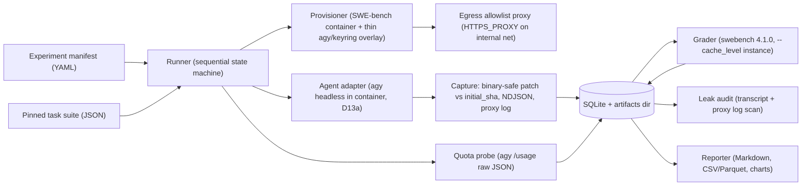

# SubscriptionBench: Implementation Plan (MVP: Antigravity + Google AI Pro)

> [!NOTE]
> **Revision 4 (2026-11-01).** Phases 0–3 and in-container SWE-bench calibration are complete (3/3 calibration tasks resolved). Incorporates empirical calibration metrics, resolves **D15** conservatively (`passes: 1` initially because `default` and `capable` share `gemini-argon-wtu-weekly`), adds a strict **zero-inference-quota development policy** for Phases 4–7, and queues targeted Phase 3 fixes alongside Phases 4–6 (see [`docs/handover_phases4_6.md`](handover_phases4_6.md)).

---

## 1. Key findings shaping the design

| # | Finding | Why it matters | Status |
|---|---|---|---|
| F1 | The **Python SDK** and `GEMINI_API_KEY` / ADC use API or GCP billing, not the consumer subscription. | Only the **`agy` CLI in headless mode** (`agy -p … --model … --output-format stream-json`), using a consumer Google OAuth login, draws down the AI Pro allowance. | Confirmed (Phase 0) |
| F2 | `agy -p /usage --output-format json` returns **double-precision floats** per bucket, contains **zero credit/monetary fields**, and **consumes zero quota**. | Per-task quota deltas are directly measurable without spending allowance (`usage_raw_schema.json`). | Confirmed (Phase 0/3) |
| F3 | **Argon and Flash draw from disjoint quota pools.** Argon (`default`, `capable`) draws **only** from `gemini-argon-wtu-weekly` (no 5h window). Flash (`efficient`) draws from `gemini-5h` and `gemini-weekly`. | Allowance is tracked per bucket (`weekly_bucket_by_config` and `primary_bucket_by_config` in `config.py`). Reports must disclose that Flash and Argon weekly pools are separate Pro allowances, and note that `default` and `capable` **share** the single `gemini-argon-wtu-weekly` pool. | Confirmed & in `config.py` |
| F4 | AI Credits overage is disabled via `--settings '{"useG1Credits": false}'`. | Passed in every headless adapter invocation (`DEFAULT_SETTINGS`). Exact 0%-quota error text remains unverified (protected by guardrail against draining the account), so `parse_stream_json` + pre/post snapshots classify near-zero errors defensively as `quota_restricted`. | Confirmed |
| F5 | `agy` returns **process exit code `0` even on auth/runtime errors** (`result.status = "ERROR"`). | `AntigravityAdapter` parses the `result` NDJSON event and never trusts exit code alone. | Implemented |
| F6 | Headless `agy` exposes web/browser tools (`search_web` runs **server-side** over Google's API), and container-wide `HTTP_PROXY` interferes with offline HTTP error tests in repos like `psf/requests`. | Combine `HTTPS_PROXY`-only egress allowlisting (`daily-cloudcode-pa.googleapis.com`, `www.googleapis.com`, `aicode.googleapis.com`, `oauth2.googleapis.com`, `accounts.google.com`; auto-updater blocked cleanly with `403`), `--disable-slash-commands`, explicit `permissions.deny` covering all web/browser tool names, and offline transcript + `proxy.log` leak auditing. | Implemented; fixes queued |
| F7 | In-container silent OAuth (D13a) works persistently via `dbus-launch` + `gnome-keyring-daemon` backed by named volume `subbench-agy-auth`. | Verified across multiple ephemeral `docker run --rm` containers and 3/3 resolved SWE-bench calibration runs with zero host credential copying. | Confirmed (Phase 3) |
| F8 | Disk & grader: `swebench==4.1.0` with `--cache_level instance` preserves the 12 pre-pulled images (~13 GB shared; **~38 GB free** on `/`). | Keep overlay layers thin and keep runtime artifacts under git-ignored `artifacts/`, never `experiments/`. | Confirmed |

---

## 2. Suite & quota conservation rules

### 2.1 Statistical framing (`verified-mvp-v1`, 12 tasks)
- **Directional, paired comparison:** With `n=12` (4 easy, 4 medium, 4 hard across 6 repos in stratified round-robin order), aggregate Wilson 95% CIs are wide (~25–75% at 6/12). Reports emphasize the **task × config outcome matrix** and paired differences alongside aggregate efficiency.
- **Conservative pass count (`k=1` first, D15):** Calibration measured `0.687 pp` of `gemini-argon-wtu-weekly` on an easy 12-tool-call task (`pytest-dev__pytest-5809`), while Flash burned **2.75× weekly / 6.3× 5h** more on a medium task (`psf__requests-2931`) than on the easy task—and 4 of the 12 suite tasks are hard (`1-4 hours`). Because `default` (`argon-medium`) and `capable` (`argon-high`) **share** `gemini-argon-wtu-weekly`, `baseline.yaml` starts at **`passes: 1`** (12 tasks × 3 configs = 36 attempts) so one complete, balanced pass finishes across all 3 configs before deciding whether remaining weekly capacity supports a second pass.
- **Bucket-specific exhaustion rules:** Flash may wait for `gemini-5h` resets (`max_5h_windows_per_config_cycle = 2`). Weekly buckets (`gemini-argon-wtu-weekly`, `gemini-weekly`) use `on_weekly_exhaustion = "abort_config"` rather than stalling for 7 days.

### 2.2 Strict quota conservation during development (Phases 4–7)
> [!IMPORTANT]
> Weekly pools (`3p-weekly`, `gemini-weekly`, `gemini-argon-wtu-weekly`) reset only once per week and are shared with interactive development. **Phases 4, 5, 6, and 7 must be built and tested with zero LLM inference calls (`0.00%` model quota burn):**
> - Test `QuotaProbe`, `Runner`, `Grader`, and `Audit` against recorded JSON/NDJSON/patch fixtures, `FakeAgentAdapter`, and `FakeQuotaProbe`.
> - Live `AgyUsageProbe` smoke tests may invoke `agy -p /usage --output-format json` at most 1–2 times (confirmed zero-cost).
> - Run real `subbench run` cycles (Phase 8) from a plain host terminal with **no concurrent Antigravity Gemini session open**, preventing background `gemini-5h` / `gemini-weekly` drift.

---

## 3. Architecture



### Repository layout

```text
SubscriptionBench/
├── pyproject.toml              # uv-managed, Python 3.12 (dev + suite groups, docker marker)
├── subbench/
│   ├── cli.py                  # Typer CLI: init-db / validate / suite / [Phases 4-6: quota / run / grade / audit]
│   ├── config.py               # Strict Pydantic v2 models (bucket-validated manifests & suites)
│   ├── store/                  # SQLite schema v2 + migrations (9 tables, WAL, FK)
│   ├── tasks/                  # Pinned HF parquet loader (.sha256 sidecar), curation, validation
│   ├── provision/              # Thin overlay builder, .git strip, egress proxy, patch capture
│   ├── agents/                 # AgentAdapter protocol, minimal-v1 prompts, AntigravityAdapter
│   ├── quota/                  # [Phase 4] QuotaProbe protocol, agy_usage.py, manual.py, guards
│   ├── runner.py               # [Phase 5] Resumable sequential state machine
│   ├── grading.py              # [Phase 6] Offline batch wrapper over swebench (--cache_level instance)
│   ├── audit.py                # [Phase 6] Outbound-scoped leak scanner over NDJSON + proxy.log
│   └── report/                 # [Phase 7] Per-bucket metrics, CIs, outcome matrix, longitudinal deltas
├── suites/                     # Frozen suite manifests & validation/image records (committed)
├── experiments/                # Experiment YAML manifests ONLY: pilot-flash.yaml, baseline.yaml
├── docker/                     # Dockerfile.agy-overlay, entrypoint-agy.sh, egress_proxy.py
├── scripts/                    # Phase 0 spikes, pull_images.py, bootstrap_container_auth.sh, calibrate_phase3.py
├── docs/                       # Plan, Phase 0/3 findings, suite docs, worker handovers
├── tests/                      # Fast offline unit tests + @pytest.mark.docker integration tests
└── artifacts/ data/ logs/      # Git-ignored runtime state, patches, transcripts, SQLite DB
```

---

## 4. Phased plan & current status

### Phase 0: Feasibility spike & calibration — **Complete** (except operator ToS check #11)
Recorded in [`docs/phase0_findings.md`](phase0_findings.md).
- [x] **1–9.** Binary (`v1.4.12`), models, `/usage` raw schema (zero credit fields, full float precision, zero cost), `stream-json` schema, D13(a) container silent auth via `subbench-agy-auth`, 5-host egress allowlist, blocked auto-updater (`403` tolerated cleanly), and headless permission settings verified.
- [x] **10. SWE-bench calibration:** 3/3 attempts resolved (`pytest-dev__pytest-5809` on Flash Medium & Argon Medium; `psf__requests-2931` on Flash Medium).
- [ ] **11. Terms of service:** Operator check of primary Antigravity terms prior to Phase 8 baseline.

### Phase 1: Scaffolding — **Complete**
- [x] `uv` project, `ruff`, `pytest`, CLI (`init-db`, `validate`, `suite`), SQLite schema `v2` (9 tables + `environment.execution_mode`), bucket-validated `QuotaPolicy` (`weekly_bucket_by_config`, `primary_bucket_by_config`, `KNOWN_BUCKETS`, 5h vs weekly exhaustion rules).

### Phase 2: Task suite curation — **Complete**
- [x] Frozen `suites/verified-mvp-v1.json` (12 tasks, 2× gold/no-op validated, `--cache_level instance`, `.sha256` dataset sidecar, 12 images pre-pulled).

### Phase 3: Provisioning and agent adapter — **Implemented** (targeted fixes queued in Phase 4–6 batch)
- [x] `docker/Dockerfile.agy-overlay`, `docker/entrypoint-agy.sh`, `subbench/provision/` (`egress_proxy.py`, `images.py`, `network.py`, `workspace.py`, `capture.py`), `subbench/agents/` (`base.py`, `prompts.py`, `antigravity.py`), unit + `@pytest.mark.docker` tests.
- [ ] **Queued fixes before Phase 5 integration** (detailed in [`docs/handover_phases4_6.md`](handover_phases4_6.md)):
  1. **Non-blocking timeout & in-container process kill (`antigravity.py`):** Stream `proc.stdout` on a reader thread so `proc.wait(timeout=...)` actually enforces the deadline, and kill the in-container `agy` process tree (`docker exec <cid> pkill -KILL ...`) on timeout so orphaned agents cannot keep burning quota or mutating `/testbed`.
  2. **`HTTPS_PROXY`-only task container env (`network.py`):** Omit plain-HTTP `HTTP_PROXY`/`http_proxy` (which caused `psf/requests` offline error tests to hit `subbench-proxy` `403` instead of `ConnectionError`, inflating Flash tool calls to 80) and centralize `DEFAULT_EGRESS_ALLOWLIST` in `network.py`.
  3. **CLI flags & exact web-tool deny names (`antigravity.py`):** Pass `--disable-slash-commands` and deny `read_url_content*`, `open_browser_url*`, `read_browser_page*`, `capture_browser_screenshot*`, `click_browser_pixel*`, `execute_browser_javascript*`, `list_browser_pages*`, and `browser_subagent*` in addition to `search_web*` and `browser_*`.
  4. **Binary-safe patch capture (`capture.py`):** Filter out binary files via `git diff --cached --numstat <initial_sha>` before `git diff` so untracked binary test outputs never emit `Binary files ... differ` lines that break `git apply`.
  5. **Per-config pass cap (`config.py`) & repo hygiene:** Add optional `ConfigSpec.max_passes` for multi-pass experiments, and relocate committed `experiments/calibration/` runtime logs to git-ignored `artifacts/calibration/`.

### Phase 4: Quota probe — **Next up** (`subbench/quota/`)
- `QuotaProbe.snapshot() -> QuotaSnapshot` (`buckets`, `taken_at`, `provenance`, `raw_json` storing unstripped `/usage` stdout).
- `AgyUsageProbe` (`subbench/quota/agy_usage.py`) using an ensured overlay image (`subbench-agy:probe`) + `subbench-agy-auth` volume; `ManualQuotaProbe` (`subbench/quota/manual.py`) fallback (`provenance='manual'`).
- Pure guard functions: `compute_attempt_deltas` (flags `invalid_reset` if `reset_time` changes or fraction increases across an attempt), `detect_external_use` (flags unexplained drops > `external_use_threshold` between `post(i)` and `pre(i+1)` on active config buckets), and `check_idle` (pre-run idle check).
- CLI: `subbench quota snapshot`.

### Phase 5: Runner — **Next up** (`subbench/runner.py`)
- Sequential, SQLite-resumable state machine: `PENDING → PROVISIONED → QUOTA_PRE → RUNNING → HALTED(reason) → CAPTURED → QUOTA_POST` (with Phase 6 advancing `QUOTA_POST → GRADED`).
- Pass-interleaved execution (`pass 0` across all configs, then `pass 1` up to `config.max_passes or manifest.passes`), respecting `manifest.task_limit`.
- Bucket-aware exhaustion: on `5h` bucket exhaustion, keep aborted attempt cost, sleep until `reset_time` (up to `max_5h_windows_per_config_cycle`), and retry (`retry_of = original.id`); on `weekly` exhaustion or `max_weekly_fraction_per_config_cycle`, halt that config for the cycle (`on_weekly_exhaustion = "abort_config"`).
- Crash/resume recovery: incomplete mid-flight attempts on restart are closed out as `infra_error` and retried cleanly; completed attempts are skipped.
- Pre-flight: `use_g1_credits is False`, Docker + suite base images present, free disk ≥ `15 GB`, silent container auth valid, idle check clean.
- CLI: `subbench run <manifest.yaml> [--db ...] [--cycle-id ...] [--dry-run]`.

### Phase 6: Grading and audit — **Next up** (`subbench/grading.py`, `subbench/audit.py`)
- **Offline batch grader (`subbench grade --cycle-id ID`):** Groups completed attempts so `instance_id`s are unique per `swebench.harness.run_evaluation --cache_level instance` invocation, short-circuits empty (`0`-byte) patches cleanly as unresolved without spinning up Docker, parses per-instance test results (`FAIL_TO_PASS` / `PASS_TO_PASS` / `patch_applied`), writes `grades`, and marks attempts `GRADED`.
- **Leak audit (`subbench audit --cycle-id ID`):** Idempotently scans `stream_json.ndjson` (scoping URL checks to outbound tool invocations/commands rather than passive repo files like `CHANGELOG.rst`) and `proxy.log` (distinguishing code/search/package host blocks from benign background Google telemetry probes), writing rows to `audit_findings` without deleting attempts.

### Phase 7: Metrics and reporting (after Phases 4–6)
- Per-bucket primary and weekly-pool efficiency, Wilson 95% CIs, median/max wall-clock, failure taxonomy, contamination/audit flags, **task × config outcome matrix**, Markdown summary + CSV/Parquet exports + charts.

### Phase 8: Pilot, then baseline
- Run from a plain host terminal (no concurrent Antigravity Gemini session): `pilot-flash.yaml` (3 tasks × Flash Medium), then `baseline.yaml` (12 tasks × 3 configs × `passes: 1`, expanding to Pass 2 only if weekly pools have comfortable margin).

### Phase 9: Longitudinal automation
- Bi-weekly systemd user timer with pre-run idle check and version/model drift tracking.

---

## 5. Decisions

### 5.1 Resolved

| ID | Decision |
|---|---|
| D1 | `agy` CLI in headless mode only (no SDK / API keys). |
| D2 / D13 | **Option (a) verified & active:** In-container `agy` using a one-time official OAuth login persisted in named Docker volume `subbench-agy-auth` (`dbus-launch` + `gnome-keyring-daemon`). **Option (c)** retained below as documented fallback. |
| D3 | Full 12-task suite per config in immutable round-robin order (`verified-mvp-v1`). Per-attempt deltas summed; 2 × 5h window cap for 5h buckets; `abort_config` on weekly bucket exhaustion. |
| D4 | `--internal` Docker network + `HTTPS_PROXY` allowlist proxy + `--disable-slash-commands` + `--settings` `permissions.deny` on web/browser tools + post-run transcript/`proxy.log` leak audit. |
| D5 / D5a | **12 tasks** frozen in `suites/verified-mvp-v1.json`. |
| D6 | Only the 3 Google Pro baselines (`default`, `efficient`, `capable`). |
| D7 / D15 | **Start baseline at `k = 1` pass (`passes: 1`), with optional `ConfigSpec.max_passes` support:** Because `default` and `capable` share `gemini-argon-wtu-weekly` and medium/hard tasks cost multiples of easy tasks, complete 1 full matched pass across all 3 configs first; run a 2nd pass (`k=2`) only when remaining weekly Argon/Gemini quota safely permits. |
| D8 | Personal Google AI Pro account with pre-run idle check, inter-attempt contamination guard, and no concurrent Gemini sessions during benchmark cycles. |
| D9 | Interrupted attempts are **discarded and re-run** when eligible (quota cost still counted). |
| D10 | SQLite as source of truth; CSV and Parquet exports. |
| D11 | Per-task wall-clock timeout: **45 minutes** (with in-container process-tree kill). |
| D12 | Minimal, versioned, SHA-256-hashed prompt template (`minimal-v1`). |
| D14 | **Config → model mapping:** `default` = `gemini-4-argon-medium`, `efficient` = `gemini-3.8-flash-medium`, `capable` = `gemini-4-argon-high`. |

### 5.2 Open pre-baseline operator item

| ID | Item | Action |
|---|---|---|
| ToS | **Terms review (Phase 0 #11)** | Operator reviews primary Antigravity terms before kicking off Phase 8 baseline. |

### 5.3 Documented fallback for D13: Option (c) — Hybrid host `agy` + air-gapped `testbed` container
*(Retained for contingency if a future `agy` update breaks headless Linux container keyring auth.)*
1. Extract `/testbed` at `base_commit` into `/tmp/subbench-attempt-<id>/testbed`, strip `.git` to `<initial_sha>`, and bind-mount at `/testbed` into a `--network none` SWE-bench container.
2. Run host `agy` (`--sandbox`, `--disable-slash-commands`, `--settings` denying web/browser tools and paths outside `/tmp/subbench-attempt-<id>/testbed`).
3. Route test execution through a single-purpose `testbed-exec` wrapper into `/opt/miniconda3/envs/testbed`, logging `execution_mode = "hybrid_host"` in `environment`.

---

## 6. Risks

| Risk | Impact | Mitigation |
|---|---|---|
| Limited weekly quotas during dev & runs | Stalls dev or truncates baseline | Zero-inference-quota testing for Phases 4–7; start `baseline.yaml` at `passes: 1`; `on_weekly_exhaustion = "abort_config"` |
| Shared `gemini-argon-wtu-weekly` across `default` & `capable` | Combined burn may approach weekly cap on hard tasks | Pass-interleaved order + optional `max_weekly_fraction_per_config_cycle` + balanced round-robin prefixes |
| Hung test subprocess inside container | Blocks runner or leaks quota past timeout | Reader thread + `proc.wait(timeout)` + `docker exec pkill -KILL` before patch capture |
| `HTTP_PROXY` env var alters repo test suites (`psf/requests`) | False test failures & wasted agent turns/quota | Set `HTTPS_PROXY` only; omit `HTTP_PROXY` so plain-HTTP offline tests fail immediately with `ConnectionError` |
| Untracked binary files generated during tests | `Binary files differ` breaks `git apply` in grading | Filter out binary numstat entries in `capture.py` |
| Concurrent Antigravity session on same Google account | Contaminates `gemini-5h` / `gemini-weekly` / Argon | Run Phase 8 from a plain host terminal; pre-run idle check + `external_use` guard |
| Disk headroom (`~38 GB` free on `/`) | Image or log bloat fills partition | Thin overlays, `--cache_level instance`, pre-flight free-disk check, artifacts git-ignored |
